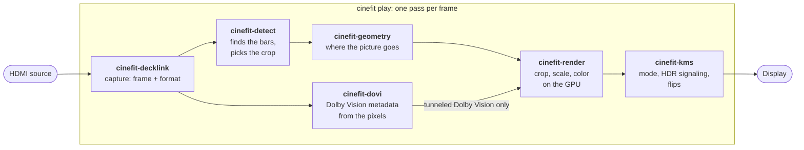

  <picture>
    <source media="(prefers-color-scheme: dark)" srcset="docs/logo/cinefit-light-accent.svg">
    
  </picture>

# cinefit

Runs on Linux with Blackmagic's Desktop Video driver. It builds and its tests
run on any platform; without the driver, it reports that it is not loaded.

## How it fits together

`cinefit play` takes every frame through the same path. The capture card
hands over the newest frame, the bar detector finds the picture inside it,
the geometry places that picture at constant image height, the renderer
crops and scales it on the GPU, and the display code flips it out at the
next vblank. The detector reads YCbCr input only: a Dolby Vision tunnel or
RGB input keeps the last crop, and `detect.crop = off` skips it. Each step is
its own crate, and none of them knows about the others; the `cinefit` crate
wires them together and holds the settings.

## License

Licensed under either of

- Apache License, Version 2.0 ([LICENSE-APACHE](LICENSE-APACHE) or <https://www.apache.org/licenses/LICENSE-2.0>)
- MIT license ([LICENSE-MIT](LICENSE-MIT) or <https://opensource.org/licenses/MIT>)

at your option.

Third-party code vendored in this repository is under its own license, kept
next to it:

- Blackmagic Design DeckLink SDK headers:
  [crates/cinefit-decklink/vendor/decklink-sdk/LICENSE](crates/cinefit-decklink/vendor/decklink-sdk/LICENSE)
- The Inter typeface, for on-screen text, under the SIL Open Font License 1.1:
  [crates/cinefit/assets/fonts/OFL-Inter.txt](crates/cinefit/assets/fonts/OFL-Inter.txt)

cinefit's binary links [libplacebo](https://code.videolan.org/videolan/libplacebo)
statically, under the GNU LGPL 2.1 or later; its licence is in each release
archive. To link cinefit against a modified libplacebo, build it with
[scripts/build-libplacebo.sh](scripts/build-libplacebo.sh) (or point
`CINEFIT_LIBPLACEBO` at your own prefix) and rebuild cinefit from the source of
the same version.

Unless you explicitly state otherwise, any contribution intentionally submitted
for inclusion in the work by you, as defined in the Apache-2.0 license, shall be
dual licensed as above, without any additional terms or conditions.
