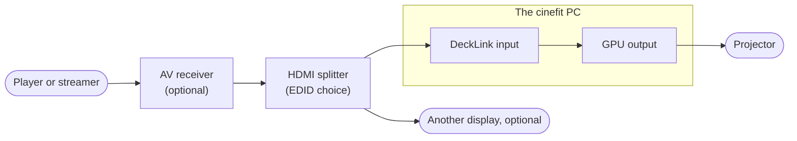

# The signal chain

The receiver is optional; it is there for audio, and cinefit can read its input names ([Receiver and Apple TV](/integrations/)).

## What the capture card accepts {#accepts}

**The capture card accepts only signals without HDCP.** Most commercial players protect their output, and a protected signal gives no picture: the slate says **No signal**. cinefit does not remove or bypass copy protection; what reaches the card is up to the equipment upstream.

## Why a splitter

A splitter between the receiver and the card decides which EDID the player sees, and so which kind of signal it sends, independently of the projector and the receiver. Its second output can feed another display.

## The EDID decides what the player sends

A player chooses its output from the **EDID** it sees: the description of the display at the end of the cable. With a splitter in the chain, the player sees the splitter's EDID, not the card's or the projector's. That choice decides which kind of signal reaches cinefit:

| What the splitter presents | What a player sends | What cinefit does |
|---|---|---|
| A copy of the capture card's EDID | HDR10 and SDR, YCbCr 4:2:2 | Passes HDR10 through, or tone maps it ([`output.mode`](/settings/#output-mode)) |
| A Dolby Vision display (TV-led) | Dolby Vision tunneled in 10-bit RGB | Decodes it and maps it to SDR BT.2020 |
| A low-latency Dolby Vision display (LLDV) | Dolby Vision already mapped by the player | Shows it as is; set [`output.white_nits`](/settings/#output-white-nits) to the EDID's declared peak (often 96) |

::: callout warning "Watch for RGB and 4:4:4"
Some EDID presets make players send RGB or YCbCr 4:4:4. cinefit's bar detector reads only YCbCr, so with RGB the crop stays where it was. Formats cinefit cannot render show a slate saying **Can't show this format · set the player to YCbCr**. The most reliable choice is YCbCr 4:2:2, 10-bit.
:::

## Player settings

- **Color mode**: YCbCr (Auto usually ends up there with the EDIDs above).
- **Deep color**: Auto or 10-bit.
- **Frame rate**: match the content (for example "Match Frame Rate" on an Apple TV), so films arrive at 23.976 or 24.

## Be gentle with the input EDID

Every change to an EDID anywhere in the chain is a hotplug: the player renegotiates and picks its format again. Some receivers then send a black picture until their input is switched away and back. cinefit never writes the card's EDID, and only `cinefit probe --edid` reads it, as an explicit choice, since even a read may be a hotplug.

Next: [First picture](/first-picture/).
